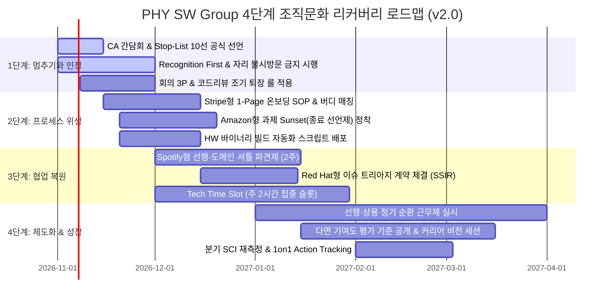

# 03. 단·중·장기 대책 & 리더십 액션 — Leadership Action Designer (v2.0 완전 개정본)

> **작성일**: 2026-10-29  
> **설계 에이전트**: Leadership Action Designer  
> **입력 데이터**: `docs/01_진단_결과.md` (v2.0 173건 진단), `docs/02_병목_StopList.md` (v2.0 Stop-List 10선), `docs/04_빅테크_사례.md` (v2.0 벤치마크 7선)  
> **핵심 원칙**: 사과는 짧고 담백하게, 실행은 "언제까지 무엇을 멈추고 시스템을 어떻게 바꾸겠다"로 구체화. 12대 확장 카테고리 전수 커버.

---

## 결론 (먼저)

- **단기 (0~1개월 — 신뢰 회복 & 멈추기)**:
  - **Stop-List 10선 공식 선언**: 그룹장 불시 자리 방문 중단, 가이드 없는 구두 지시 중단, 종료 기준 없는 과제 중단.
  - **Recognition First 즉각 시행**: 이슈 해결 후 24시간 내 공개 인정 선행, Post-mortem은 1주일 뒤 Blameless로 전환.
  - **회의 3P & 조기 퇴장 룰**: 다인원 목적 없는 회의 폐지, 코드리뷰 시 본인 순서 종료 즉시 자유 퇴장.
- **중기 (1~3개월 — 프로세스 위생 & 협업 복원)**:
  - **Spotify형 선행-도메인 셔틀 파견제**: 선행 파트 개발자가 도메인 파트에 2주간 파견되어 상용 코드에 실무 툴을 함께 적용.
  - **Stripe형 1-Page 온보딩 SOP & 1:1 버디제**: 신규 업무 부여 시 1장 체크리스트와 전담 사수 공식 매칭.
  - **Amazon형 과제 Sunsetting (공식 종료 선언제)**: 모든 개선 과제에 마감일과 회고일을 확정하여 '용두사미' 근절.
  - **HW 바이너리 빌드 자동화 스크립트 배포**: 주니어의 단순 반복 빌드 노가다 시간 80% 감축.
- **장기 (3~12개월 — 정체성·R&R & 제도화)**:
  - **모뎀 개발팀-PHY 공식 R&R 협약**: Red Hat식 트리아지 계약을 맺어 1차 분석 없는 단순 키워드 토스 차단.
  - **선행·상용 정기 직무 순환 근무제**: 도메인 엔지니어가 선행 브링업 및 알고리즘 과제에 순환 참여.
  - **다면 기여도 인정 체계 투명화**: 상용 이슈 해결 및 온보딩 기여도를 고과에 공정하게 반영.

---

## 1. 단·중·장기 대책 표 (15대 실행 과제)

### 단기 (0~1개월) — "멈추기와 인정하기 (신뢰 회복 신호)"

| # | 대책 명칭 | 구체적 실행 방안 (빅테크 벤치마크 연계) | 담당 오너 | 성공 지표 (KPI) | 대응 고충 |
|---|---|---|---|---|---|
| **S1** | **Stop-List 10선 공식 선언** | 간담회 오프닝에서 "하지 말아야 할 10가지"를 그룹장이 직접 공표하고 보류 과제 목록 공개 | 그룹장 | 정기 회의 30% 감축, 보류 과제 공표 | 리더십 소통, 회의 비효율 |
| **S2** | **그룹장 소통 방식 리셋** | **Netflix No Drop-in**: 불시 자리 방문 전면 금지, 48시간 전 사전 예약 1on1 및 TL 공식 창구 활용 | 그룹장 | 자리 불시 방문 0건, 사전 예약 100% | 리더십 소통 |
| **S3** | **Recognition First (인정 먼저)** | **Google SRE**: 이슈 해결 직후 24시간 내 공개 칭찬(당근) 선행, 회고는 1주 뒤 Blameless로 진행 | 그룹장, TL | 해결 건당 감사 메시지 100% | 인정 & 심리적 안전감 |
| **S4** | **회의 3P & 조기 퇴장 룰** | **Shopify**: 3P(Purpose·Product·People) 미충족 회의 폐지, 코드리뷰 시 본인 파트 완료 후 즉시 자유 퇴장 | 그룹장, TL | 회의 3P 기재율 100%, 체류 시간 단축 | 회의 비효율 |
| **S5** | **레거시 칩셋 폴더 정리** | **MS GVFS**: 상용화 계획 없는 폴더 archive 브랜치 분리 보관 후 메인 브랜치에서 일괄 제거 | TL, 시니어 | PR/CL 영향 폴더 수 70% 감소 | GitHub/VCS |

---

### 중기 (1~3개월) — "프로세스 위생 & 협업 복원"

| # | 대책 명칭 | 구체적 실행 방안 (빅테크 벤치마크 연계) | 담당 오너 | 성공 지표 (KPI) | 대응 고충 |
|---|---|---|---|---|---|
| **M1** | **선행-도메인 셔틀 파견제** | **Spotify Shuttle**: 선행 개발자가 도메인 파트에 2주간 파견되어 상용 코드에 신규 툴을 함께 적용 | 파트장 | 도메인 파트 툴 실무 적용 건수 | 협업·R&R, 소통·배경설명 |
| **M2** | **1-Page 온보딩 SOP & 버디제** | **Stripe Spin-up**: 장비 구매, 새 툴 등 20대 핵심 업무에 1장 가이드 배포 및 1:1 전담 사수 공식 매칭 | TL, 파트장 | 가이드 없는 구두 지시 0건 | 프로세스 & 온보딩 |
| **M3** | **과제 공식 종료 선언제 (Sunset)** | **Amazon Sunsetting**: 모든 과제에 마감일과 회고일을 사전 확정하고, 종료 시 공식 완료 공표 (용두사미 차단) | 그룹장, TL | 완료 과제 공식 회고율 100% | 프로세스 & 온보딩, 과제 과중 |
| **M4** | **HW 바이너리 빌드 자동화** | **Tesla BaaS**: HW 블록 변경 시 수작업 바이너리 컴파일/플래싱을 자동화 스크립트로 대체 | 시니어 | 빌드 소요 시간 80% 감축 | 이슈처리 구조, 정체성·커리어 |
| **M5** | **GitHub 시니어-주니어 페어링** | 시니어 1명 + 주니어 2명 페어링(2주 단위), 브랜치 전략 1장 가이드 배포 및 rebase 충돌 실습 | 시니어 | PR 리드타임 반나절 이내 단축 | GitHub/VCS |
| **M6** | **Tech Time Slot (주 2시간)** | AX 도구 실습 및 기술 스킬업을 위한 공식 업무 시간 블록 지정 (회의 금지 시간대) | 그룹장 | 주 2시간 참여율 90% 이상 | AI/AX 적응, 정체성·커리어 |

---

### 장기 (3~12개월) — "정체성·R&R & 제도화"

| # | 대책 명칭 | 구체적 실행 방안 (빅테크 벤치마크 연계) | 담당 오너 | 성공 지표 (KPI) | 대응 고충 |
|---|---|---|---|---|---|
| **L1** | **모뎀팀-SSIR 공식 R&R 협약** | **Red Hat Triage**: 단순 키워드 토스 금지, 3대 필수 로그 규격 미충족 시 접수 자동 반려 SLA 체결 | 그룹장, 모뎀TL | 오할당 이슈 비율 50% 감소 | 이슈처리 구조, 협업·R&R |
| **L2** | **선행·상용 정기 순환 근무제** | 도메인 엔지니어가 선행 칩셋 브링업 및 알고리즘 개발에 정기 참여하는 6개월 순환 근무 | 그룹장, 파트장 | 연간 직무 순환 참여율 25% | 정체성·커리어, 협업·R&R |
| **L3** | **다면 기여도 인정 체계 투명화** | 상용 이슈 방어, 온보딩 가이드 작성, 멘토링 기여도를 고과에 공정하게 반영하는 기준 공개 | 그룹장 | 평가 공정성 만족도 향상 | 보상·평가, 인정 & 심리적 안전감 |
| **L4** | **분기별 커리어 비전 세션** | 모뎀 PHY 엔지니어의 3~5년 성장 경로(선행/상용/AX/시스템)를 제시하는 그룹장 비전 세션 | 그룹장 | 분기 1회 정례 실시 | 정체성·커리어 |

---

## 2. 그룹 CA·파트 총무 간담회 오프닝 스크립트 (v2.0)

> **상황**: 그룹장이 간담회를 열며 173건 1on1 전수 분석 결과를 솔직히 인정하고 'Stop-List 선언'과 '소통 방식 리셋'을 발표하는 5분 오프닝 발화문.

```text
"바쁜 일정 중에 자리해 주신 각 파트 CA 분들과 총무 분들께 진심으로 감사드립니다.

이번에 우리 그룹원 173건의 1on1 피드백 전수를 한 문장도 빠짐없이 읽었습니다. 
솔직히 리더로서 얼굴이 화끈거리고 가슴이 매우 먹먹했습니다.

'그룹장이 자리에 불쑥 찾아오면 조급함과 불안이 그대로 전이되어 엄청난 압박을 느낀다',
'새 업무를 줄 때 가이드도 없이 알아서 물어보라고만 하니 맨땅에 헤딩하는 기분이다',
'선행 파트가 생기고 나서 우리는 뒤처지고 단순 짬통과 테스트 수족이 된 것 같다',
'어려운 이슈를 밤새워 해결해도 당근 하나 없이 곧바로 보고서 숙제만 떨어진다'는 
생생한 목소리들을 보며, 제가 혁신과 속도라는 이름으로 구성원 여러분께 얼마나 깊은 피로감과 상처를 주었는지 뼈아프게 깨달았습니다.

더 이상 여러분께 '더 열심히 해달라'는 말씀은 드리지 않겠습니다.
오늘 이 자리의 목적은 '더하기'가 아니라 '버리기(Stop)'입니다.

첫째, 제 자신의 소통 방식부터 멈추겠습니다. 
앞으로 사전 어젠다 없이 여러분의 자리에 불쑥 찾아가 진행 상황을 묻는 일은 완전히 중단하겠습니다. 모든 소통은 파트장과 TL을 통한 공식 채널을 지키고, 1on1은 여러분이 편안한 시간에 사전 예약된 슬롯으로만 진행하겠습니다.

둘째, 가이드 없는 구두 지시와 용두사미 과제를 멈추겠습니다.
장비 구매든 새 툴이든 1장짜리 온보딩 SOP와 전담 버디 매칭 없이는 절대 업무를 맡기지 않겠습니다. 시작만 요란하고 끝이 흐지부지되던 개선 과제들은 오늘부로 10대 Stop-List를 통해 공식 보류하고, 끝을 맺은 과제는 전체가 함께 축하하고 회고하겠습니다.

셋째, 고생한 분들께 '인정(당근)'을 먼저 드리겠습니다.
이슈를 해결한 분들께 즉시 감사와 인정을 먼저 표현하고, 회고(Post-mortem)는 1주일 뒤 다 함께 배우는 자리로 바꾸겠습니다.

오늘 이 자리는 제가 말하는 자리가 아니라, 여러분이 현장의 목소리를 들려주시는 자리입니다. 
우리가 당장 무엇을 더 멈춰야 할지(Stop), 무엇을 시작하고(Start), 무엇을 지켜야 할지(Continue), 가감 없이 말씀해 주십시오. 그룹장인 제가 끝까지 듣고 하나하나 바꾸어 나가겠습니다. 감사합니다."
```

---

## 3. 4단계 리커버리 로드맵


