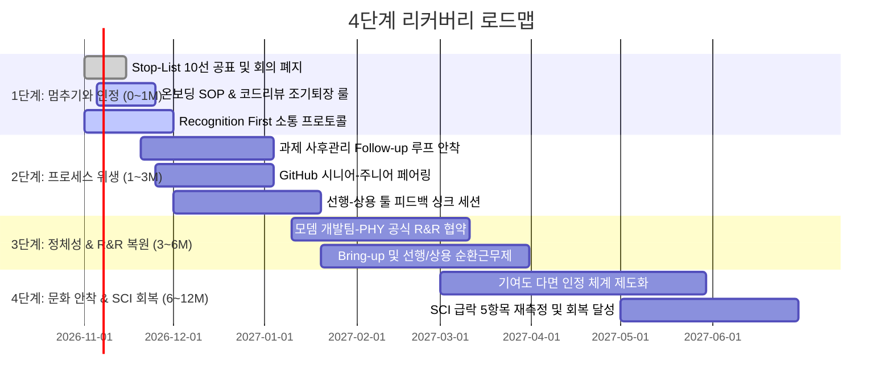

# 03. 단·중·장기 대책 & 리더십 액션 — Leadership Action Designer (v2.0)

> **입력**: `docs/01_진단_결과.md` (v2.0), `docs/02_병목_StopList.md` (v2.0), `docs/04_빅테크_사례.md` (v2.0)
> **원칙**: 사과는 짧게, 약속은 "언제까지 무엇을 멈추고 시스템을 어떻게 바꾸겠다"로 구체화합니다. 12대 확장 카테고리 고충을 전수 커버합니다.

---

## 결론 (먼저)

- **단기 (0~1개월 — 신뢰 회복 & 멈추기)**:
  - Stop-List 10선 공식 선언, 3P 회의 선언 및 코드리뷰 조기 퇴장 룰, 신규 업무 온보딩 SOP 의무화, Recognition First(인정 먼저) 즉시 적용.
- **중기 (1~3개월 — 프로세스 위생 & 협업 복원)**:
  - 선행-상용 툴 피드백 루프, Bring-up 로테이션, 과제 사후관리(Follow-up) 공식화(용두사미 차단), HW 바이너리 빌드 자동화, GitHub 시니어-주니어 페어링.
- **장기 (3~12개월 — 정체성·R&R & 제도화)**:
  - 모뎀 개발팀-PHY 간 공식 R&R 협약(수족 테스트 탈피), 선행·상용 정기 직무 순환, 공정하고 투명한 기여도 인정 체계, 분기별 SCI 및 1on1 Action Tracker 운영.

---

## 1. 단·중·장기 대책 표 (12대 카테고리 매핑)

### 단기 (0~1개월) — "멈추기와 인정하기"

| # | 대책 명칭 | 핵심 내용 및 실행 방안 | 담당 | 성공 지표 | 대응 고충 |
|---|---|---|---|---|---|
| **S1** | **Stop-List 10선 공식 선언** | 방향 미정 회의, 종료 기준 없는 과제, 구두 지시 등 10개 항목 중단 공지 | 그룹장 | 정기 회의 30% 감축, 보류 과제 목록 공개 | 회의 비효율, 과제 과중 & 리소스 |
| **S2** | **레거시 칩셋 폴더 정리** | 미사용 칩셋 폴더 archive 브랜치 분리 및 메인 브랜치 제거 | TL, 시니어 | CL/PR 영향 폴더 수 70% 감소 | GitHub/VCS |
| **S3** | **회의 3P & 조기 퇴장 룰** | 3P(Purpose·Product·People) 기재 강제, 코드리뷰 시 본인 파트 완료 후 자유 퇴장 | 그룹장, TL | 3P 기재율 100%, 회의 체류 시간 단축 | 회의 비효율, 프로세스 & 온보딩 |
| **S4** | **Recognition First (인정 먼저)** | 이슈 해결 직후 24시간 내 공개 인정 메시지 발송, Post-mortem은 1주 후 Blameless 진행 | 그룹장, TL | 이슈 해결 건당 인정 메시지 100% | 인정 & 심리적 안전감, 리더십 소통 |
| **S5** | **신규 업무 온보딩 SOP 의무화** | 장비 구매, 신규 툴 등 새 업무 부여 시 1장 체크리스트 및 1:1 온보딩 버디 필수 매칭 | TL, 파트장 | 온보딩 SOP 없이 구두 지시 0건 | 프로세스 & 온보딩 |
| **S6** | **그룹장 소통 방식 리셋** | 자리 불시 방문 금지, 사전 예약 기반 1on1 및 TL 중심 공식 채널 소통 | 그룹장 | 자리 불시 방문 0건, 사전 예약 100% | 리더십 소통 |
| **S7** | **CA·파트 총무 간담회** | Stop-Start-Continue 워크숍 실시 (청취 중심 오프닝 스크립트 발화) | 그룹장 | Stop/Start/Continue 도출 및 즉시 조치 | 전 카테고리 |

### 중기 (1~3개월) — "프로세스 위생 & 협업 복원"

| # | 대책 명칭 | 핵심 내용 및 실행 방안 | 담당 | 성공 지표 | 대응 고충 |
|---|---|---|---|---|---|
| **M1** | **선행-도메인 툴 피드백 싱크** | 선행 파트 툴을 도메인 파트에 시연하고 실무 피드백을 받는 격주 30분 세션 정례화 | 파트장 | 도메인 파트 피드백 반영 건수 | 협업·R&R, 소통·배경설명 |
| **M2** | **과제 완료 공식 선언제 (Follow-up)** | 모든 개선 activity에 마감일과 사후 회고 세션 강제, 완료 시 공식 종결 공지 (용두사미 차단) | 그룹장, TL | 완료 과제 공식 회고율 100% | 프로세스 & 온보딩, 과제 과중 |
| **M3** | **HW 바이너리 빌드 자동화** | 반복적인 HW 테스트 바이너리 생성 스크립트 구축 및 배포 | 시니어 | 빌드 소요 시간 80% 단축 | 이슈처리 구조 |
| **M4** | **Bring-up 순환 로테이션** | Bring-up 업무 특정 인원 고정 탈피, 파트 간 3~6개월 단위 순환 근무 | 파트장 | 순환 참여 인원 수 | 정체성·커리어, 협업·R&R |
| **M5** | **GitHub 멘토링 페어링** | 시니어 1명 + 주니어 2명 페어링 (2주 단위), 브랜치 전략 1장 가이드 배포 | 시니어 | PR 리드타임 반나절 이내 | GitHub/VCS, 협업·R&R |
| **M6** | **Tech Time Slot (주 2시간)** | AX 도구 실습 및 기술 스킬업을 위한 공식 업무 시간 블록 (회의 금지 시간) | 그룹장 | 주 2시간 참여율 90% 이상 | AI/AX 적응, 정체성·커리어 |
| **M7** | **TL 중심 1장 과제 브리프** | 과제 할당 시 "목적·배경·마일스톤·하지 말아야 할 것" 1장 브리프 필수화 | TL | 과제 브리프 작성률 100% | 소통·배경설명 |
| **M8** | **초보자 이슈 처리 플로우차트** | PHY 종단 짬처리 방지를 위한 1차 스크리닝 체크리스트 및 가이드 배포 | 시니어 | 신규자 이슈 처리 만족도 | 이슈처리 구조 |

### 장기 (3~12개월) — "정체성·R&R & 제도화"

| # | 대책 명칭 | 핵심 내용 및 실행 방안 | 담당 | 성공 지표 | 대응 고충 |
|---|---|---|---|---|---|
| **L1** | **모뎀 개발팀-PHY 공식 R&R 협약** | 단순 수족형 테스트 관행 탈피, 1차 재현 검증 및 원인 분석 R&R 명문화 | 그룹장, 모뎀TL | 오할당 이슈 비율 50% 감소 | 정체성·커리어, 협업·R&R |
| **L2** | **선행·상용 정기 직무 로테이션** | 상용 파트 엔지니어가 선행 알고리즘 과제에 정기적으로 참여하는 순환 체계 구축 | 그룹장, 파트장 | 연간 직무 순환율 25% | 정체성·커리어, 보상·평가 |
| **L3** | **기여도 다면 인정 체계** | 상용 이슈 해결, 온보딩 가이드 작성, 멘토링 기여도를 공정하게 반영하는 기준 공개 | 그룹장 | 평가 투명성 만족도 | 보상·평가, 인정 & 심리적 안전감 |
| **L4** | **분기별 커리어 비전 세션** | 모뎀 PHY 엔지니어의 3~5년 성장 경로(선행/상용/AX/시스템) 분기 1회 제시 | 그룹장 | 분기 1회 실시 | 정체성·커리어 |
| **L5** | **SCI & 1on1 Action Tracker 대시보드** | 대시보드 내 Action 이행 현황 공개 및 분기별 미니 설문 추적 | 그룹장, CA | SCI 급락 5항목 완전 회복 | 전 카테고리 |

---

## 2. 그룹 CA·파트 총무 간담회 오프닝 스크립트 (v2.0)

> **상황**: 그룹장이 간담회를 열며 120건 1on1 전수 분석 결과를 솔직히 인정하고 '버리기'를 선언하는 발화문 (5분 분량)

"오늘 모신 이유는 제가 여러분께 무언가를 지시하거나 설득하기 위해서가 아니라, **제가 만든 문제를 솔직하게 인정하고 먼저 듣기 위해서**입니다. 전수 1on1 결과를 읽으며 리더로서 깊은 반성을 했습니다. 세 가지만 분명하게 말씀드리고 듣겠습니다.

**첫째, 일에 쫓기는 제 조급함과 불안이 여러분에게 엄청난 심리적 압박으로 전달되었습니다.**  
배경 설명도 없이 과제를 불쑥 던졌고, 개선하겠다고 벌려놓은 일들은 마무리를 확인하지 않아 용두사미가 되었습니다. 새 업무를 맡은 주니어에게 가이드도 없이 알아서 물어보라며 방치했습니다. 고생해서 어려운 이슈를 해결했을 때, 고맙다는 인정 대신 'TC 추가하고 포스트모템 쓰라'며 숙제부터 얹었습니다. 그 부담과 상처는 모두 리더인 제가 만든 것입니다.

**둘째, 오늘부터 더하지 않고 공식적으로 '빼겠습니다.'**  
방향이 정해지지 않은 다인원 회의와 중복 보고 회의를 즉시 없애겠습니다. 가이드 없는 신규 업무 구두 지시를 금지하고, 종료 기준이 없는 과제는 오늘부로 공식 보류하겠습니다. 이 자리에서 여러분과 함께 확정할 **Stop-List 10선**을 이번 주 전체 그룹에 공표하겠습니다.

**셋째, '인정(Recognition)'을 모든 프로세스의 맨 앞에 두겠습니다.**  
이슈를 해결하면 칭찬과 인정을 먼저 하겠습니다. 포스트모템은 처벌이나 숙제가 아니라, 실수를 통해 조직이 함께 배우는 Blameless 학습 세션으로 리셋하겠습니다. 선행 파트와 도메인 파트가 위화감 없이 성과와 툴을 공유하고 서로 순환할 수 있는 구조를 제가 직접 책임지고 만들겠습니다.

오늘 워크숍은 멈출 것(Stop), 시작할 것(Start), 계속할 것(Continue) 세 가지입니다. **멈출 것부터 솔직하게 적어주십시오.** 제가 결정할 수 있는 것은 이 자리에서 즉시 멈추겠습니다."

---

## 3. 4단계 리커버리 로드맵



---

## 대시보드 연동용 JSON 요약 블록

```json
{
  "actions": [
    {"term": "단기", "title": "Stop-List 10선 공식 선언 및 회의 30% 감축", "owner": "그룹장", "kpi": "회의 30% 감축, 보류 과제 목록 공개", "categories": ["회의 비효율", "과제 과중 & 리소스"]},
    {"term": "단기", "title": "Recognition First: 24시간 내 인정 메시지 의무화", "owner": "그룹장, TL", "kpi": "이슈 해결 건당 인정 100%", "categories": ["인정 & 심리적 안전감", "리더십 소통"]},
    {"term": "단기", "title": "신규 업무 온보딩 SOP & 버디 매칭 의무화", "owner": "TL, 파트장", "kpi": "구두 지시 0건, 온보딩 SOP 100%", "categories": ["프로세스 & 온보딩"]},
    {"term": "단기", "title": "회의 3P 및 코드리뷰 조기 퇴장 룰 시행", "owner": "TL", "kpi": "개인 코딩 집중 시간 주 2시간 회수", "categories": ["회의 비효율", "프로세스 & 온보딩"]},
    {"term": "중기", "title": "선행-도메인 툴 피드백 싱크 및 Bring-up 순환제", "owner": "파트장", "kpi": "피드백 반영 건수, 순환 인원 수", "categories": ["협업·R&R", "정체성·커리어"]},
    {"term": "중기", "title": "과제 완료 공식 선언제 (Follow-up 회고 루프)", "owner": "그룹장, TL", "kpi": "개선 과제 공식 회고율 100%", "categories": ["프로세스 & 온보딩", "과제 과중 & 리소스"]},
    {"term": "중기", "title": "HW 바이너리 빌드 자동화 스크립트 배포", "owner": "시니어", "kpi": "빌드 소요 시간 80% 단축", "categories": ["이슈처리 구조"]},
    {"term": "장기", "title": "모뎀 개발팀-PHY 공식 R&R 협약 체결", "owner": "그룹장", "kpi": "오할당 이슈 50% 감축", "categories": ["정체성·커리어", "협업·R&R"]},
    {"term": "장기", "title": "선행·상용 정기 직무 로테이션 체계 구축", "owner": "그룹장, 파트장", "kpi": "연간 직무 순환율 25%", "categories": ["정체성·커리어", "보상·평가"]}
  ]
}
```
